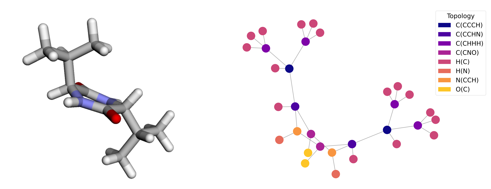

# Molecular Chirality Descriptor (mo_RMSD)



A Python-based tool for performing a chirality evaluation of molecular structures using a modified Root Mean Square Deviation: mirror-optimal RMSD (mo_RMSD) enriched by atomic environment awareness and graph-based analysis.

## Overview

The mo_RMSD (mirror-optimal RMSD) chirality descriptor quantifies the degree of chirality in molecular structures by:
- Computing the optimal superposition between a molecule and its mirror image
- Applies graph-based atomic environment analysis to improve sensitivity to molecular topology.
- Normalizing by molecular diameter to provide scale-independent descriptors
- Employing parallel processing for efficient exploration of rotational space

## Installation

```bash
# Clone the repository
git clone https://github.com/Elenaze/chirality_descriptor
cd chirality_descriptor

# Install dependencies
pip install -r requirements.txt
```

## Core Algorithm

### 1. **Molecular Preprocessing**
- Parse XYZ coordinate files
- Translate molecules to center of mass
- Align with principal axes of inertia

### 2. **Atomic Environment Analysis**
- Calculate atomic neighbors using distance cutoffs: `d_cutoff = α × (r_i + r_j)`
- Create atomic environment fingerprints
- Default α = 1.25 (optimized from PDF analysis)

### 3. **Mirror Image Generation**
- Generate enantiomer by coordinate inversion
- Apply systematic rotational search (angle_step for the grid-search can be fine-tuned)
- Use Hungarian algorithm for optimal atom assignment

### 4. **Chirality Descriptor Calculation**
- Compute environment-sensitive RMSD for each rotation
- Find minimum RMSD across all rotations
- Normalize by molecular diameter: `χ = RMSD_min / d_molecule`

## Usage

### Configuration-Based Interface

The script has been streamlined to use a simple configuration file approach, focusing on single-structure analysis for a single chirality evaluation.

#### **Setup and Usage:**

1. **Create a config.txt file** with four parameters:
```bash
# config.txt
1.25                     # alpha value for atomic environment analysis
5                        # angle_step in degrees  
8                        # n_processes (number of CPU cores)
data/SR/cAlaAla          # directory containing .xyz files (relative to script root)
```

2. **Run the analysis:**
```bash
python main.py
```

### Configuration Parameters

- **alpha**: Atomic environment sensitivity parameter (typical range: 1.0-2.0)
  - 1.25 = standard (optimized from PDF analysis)
  - 1.5 = increased sensitivity to distant neighbors
  - 1.0 = tight neighbor cutoff
- **angle_step**: Angle increment for rotational search (degrees)
  - 5° = high precision (~186,624 combinations)
  - 30° = standard analysis (~1,728 combinations)
  - 90° = quick testing (~64 combinations)
- **n_processes**: Number of CPU processes to use
- **directory**: Path to directory containing .xyz files (relative to script location)

## Output Files

### **Streamlined Output - CSV Only**

To eliminate redundancy and maximize reusability, the script produces **a CSV output**:

### **CSV Structure:**
```csv
system,filename,chirality_value,alpha,angle_step,processing_time,timestamp
cAlaAla,2.log-geo-final.xyz,0.167479,1.25,30,4.51,2025-09-24 10:30:15
```

### **Output Directory:**
```
output/
├── {filename}_step_{angle_step}.csv    # All results in one file
└── errors_{angle_step}.log             # Error log (if needed)
```

### **Performance Optimization:**
- Use larger angle steps for initial screening
- Consider system complexity when setting precision

## References

- A. B. Buda and K. Mislow, “A hausdorff chirality measure,” Journal of the
American Chemical Society 114, 6006–6012 (1992).
- I. L. Garzón, J. A. Reyes-Nava, J. I. Rodriguez-Hernandez, I. Sigal, M. Bel-
trán, and K. Michaelian, “Chirality in bare and passivated gold nanoclus-
ters,” Physical Review B 66, 073403 (2002).
- M. Cha, J. Ma, J.-Y. Kim, E. S. T. Emre, and N. A. Kotov, “Graph-
theoretical chirality measure and chirality–property relations for chemi-
cal structures with multiscale mirror asymmetries,” Chirality 36, e23678
(2024).

## License

This software is provided as-is for research purposes.